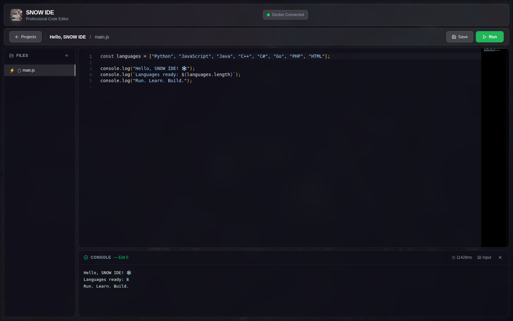

# ❄️ SNOW IDE

[](https://github.com/snowtravit/snow-local-ide/actions/workflows/ci.yml)
[](https://github.com/snowtravit/snow-local-ide/releases/latest)
[](LICENSE)
[](#-language-images)

A local browser IDE with a Monaco editor, a project/file panel, and a console for running small programs. The frontend uses React, TypeScript, Vite, and Tailwind CSS; the backend uses Node.js, Express, and Dockerode.

Code runs in Docker by default. Local execution must be enabled explicitly. If Docker or a language image is unavailable, the backend reports an error instead of running code on the host.

## ✨ What you can do

- 📝 Write code in Monaco with syntax highlighting, local language workers, and **Ctrl/Cmd + S**.
- 📂 Organize projects and files, including nested paths and relative imports.
- 🐳 Run **eight languages** in Docker, provide stdin, inspect output, and stop a running program.
- 💾 Keep edited text when switching files or when a save fails; retry from the visible error message.



*An actual local run: JavaScript in Docker, with exit code 0. [Screenshot details](docs/SCREENSHOTS.md).*

[📦 Latest release](https://github.com/snowtravit/snow-local-ide/releases/latest) · [📝 Changelog](CHANGELOG.md) · [⚖️ License and notices](THIRD_PARTY_NOTICES.md)

## 🧰 Requirements

- Node.js 20.19+ or 22.12+ from a supported release, with npm.
- A running Docker daemon accessible to the backend for the default execution mode.
- Internet access for installing dependencies and building images.

The API has no authentication. The backend and Vite development server bind to `127.0.0.1` by default. Keep this application local; it is not ready to be exposed as a public code-execution service.

## 📦 Release download

Download [SNOW-IDE-v1.1.0.zip](https://github.com/snowtravit/snow-local-ide/releases/download/v1.1.0/SNOW-IDE-v1.1.0.zip) for the compiled backend and frontend, or [the source archive](https://github.com/snowtravit/snow-local-ide/releases/download/v1.1.0/snow-local-ide-v1.1.0-source.zip) to build from source.

For the compiled archive:

1. Extract it and open a terminal in `SNOW-IDE-v1.1.0/SNOW CODING CORP/backend`.
2. Run `npm ci --omit=dev` with a supported Node.js version.
3. Start Docker, then build the language images from `SNOW CODING CORP` using `bash docker/build-images.sh` or `docker\build-images.bat` on Windows Command Prompt.
4. Return to the backend directory and run `npm start`.
5. Open **http://127.0.0.1:4000**. The backend serves the compiled frontend and the API together.

The archive does not include Node.js, npm packages, or built Docker images. The requirements and Docker socket instructions below still apply.

## 🚀 Manual setup

Clone the repository and install dependencies:

```bash
git clone https://github.com/snowtravit/snow-local-ide.git
cd "snow-local-ide/SNOW CODING CORP/backend"
npm ci
cd ../frontend
npm ci
cd ..
```

Start Docker, then build the language images from `SNOW CODING CORP`:

```bash
docker info
bash docker/build-images.sh
```

On Windows Command Prompt, use `docker\build-images.bat` instead. Check the output for failed builds; the script attempts each image independently. The backend defaults to `/var/run/docker.sock`. For Docker Desktop on Windows, set the named pipe in the backend terminal before starting it:

```powershell
$env:DOCKER_SOCKET = "//./pipe/docker_engine"
```

Linux and WSL2 can use the Unix socket when Docker integration is configured. The backend user must have access to the chosen socket.

In one terminal, start the backend:

```bash
cd "snow-local-ide/SNOW CODING CORP/backend"
npm run dev
```

In another terminal, start the frontend:

```bash
cd "snow-local-ide/SNOW CODING CORP/frontend"
npm run dev
```

These terminal paths assume you start in the directory where you cloned the repository. Open <http://127.0.0.1:3000>. The frontend proxies `/api` requests to `http://127.0.0.1:4000`.

Create a project, select a language, edit a file, and run it to see its output. The active file is the entry point; the other project files are included so relative imports can resolve. Renamed files and nested paths are supported. This runs a small program rather than a general project build system.

The editor and its language workers are bundled locally and do not require a CDN. Saving, creating a file, and changing files or projects preserve current edits. Failed saves keep the edited text and show an error for retry. Stop cancels the active execution, including a request that is still being prepared.

## 🌐 Language images

Versions come from the checked-in Dockerfiles. Local mode uses the runtimes installed on your machine.

| Language | Docker runtime | Image tag | Default filename |
| --- | --- | --- | --- |
| Python | Python 3.12; NumPy, pandas, requests included | `snow-ide-python` | `main.py` |
| JavaScript | Node.js 22 | `snow-ide-javascript` | `main.js` |
| Java | Eclipse Temurin JDK 21 | `snow-ide-java` | `Main.java`, class `Main` |
| C++ | GCC 13; C++17 compilation | `snow-ide-cpp` | `main.cpp` |
| C# | .NET SDK 8; offline SDK project | `snow-ide-csharp` | `main.cs` |
| Go | Go 1.25 | `snow-ide-go` | `main.go` |
| PHP | PHP CLI 8.3 | `snow-ide-php` | `main.php` |
| HTML | Alpine 3.23 with `cat` | `snow-ide-html` | `index.html` |

HTML execution prints file contents to the console; it is not a rendered browser preview. Docker execution has no network access, so additional dependencies must be included in the image rather than downloaded by a running program.

## 🐳 Execution modes

`EXECUTION_MODE=docker` is the default. Each run creates a container with networking disabled, a process limit of 100, and language-specific limits of 128–512 MiB memory and 0.25–0.5 CPU. Execution times out after 10 seconds for HTML and 30 seconds for other languages. The service attempts to stop and remove the container after each run, including errors and timeouts.

All language images run as `nobody` with a writable `/code` workspace. Captured output is limited to 100 KiB; exceeding the limit stops the program. These basic limits are not a guarantee of safe execution of hostile code. Use the project for local development with code you trust.

To deliberately run your own trusted code on the host, start the backend in local mode:

```bash
# Linux/macOS, from the backend directory
EXECUTION_MODE=local npm run dev
```

```powershell
# Windows PowerShell, from the backend directory
$env:EXECUTION_MODE = "local"
npm run dev
```

Local mode checks portable runtimes under `SNOW CODING CORP/runtimes` and then system runtimes on `PATH`. Programs run with the backend user's host permissions and can access that user's files and network. Docker memory, CPU, process, and network limits do not apply. A missing local runtime produces an error; it does not switch execution modes.

## ⚙️ Configuration and storage

Set environment variables before starting the backend. They are not loaded automatically from a `.env` file.

| Variable | Default | Purpose |
| --- | --- | --- |
| `EXECUTION_MODE` | `docker` | Accepts only `docker` or `local`. |
| `HOST` | `127.0.0.1` | Backend bind address. |
| `PORT` | `4000` | Backend port; update the Vite proxy if changed. |
| `DOCKER_SOCKET` | `/var/run/docker.sock` | Docker socket path. |
| `CORS_ORIGINS` | `http://localhost:3000,http://127.0.0.1:3000,http://localhost:4000,http://127.0.0.1:4000` | Comma-separated allowed browser origins. |
| `PROJECTS_DIR` | `backend/projects` | Project files on disk. |

Origin checks restrict browser requests; they do not authenticate API clients.

Project metadata, file records, and execution history live in `InMemoryStore` and reset when the backend restarts. File contents are also written to `backend/projects`, but the API does not reload those files into its records after a restart. Keep a separate copy of work you want to retain. PostgreSQL model files are present, but the running routes do not use them for persistence.

## 🧪 Build and checks

From the backend directory:

```bash
npm run build
npm test
npm run lint
npm audit
```

Backend tests cover execution modes, cancellation races, input validation, local process cleanup, safe file paths, renaming, and failed disk writes. To test actual language execution, build all eight Docker images, then run this from the backend directory:

```bash
npm run test:docker
```

The Docker tests run each language, renamed and nested entry files, bundled Python libraries, stdin, timeouts, output limits, isolation, Stop, and container cleanup.

From the frontend directory:

```bash
npm run build
npm run lint
npm audit
```

`npm start` in the backend runs compiled output after a build. When `frontend/dist` exists, the backend serves it at <http://127.0.0.1:4000>, alongside the API.

## 🖥️ Optional launchers

`SNOW CODING CORP/start.sh` (Linux/macOS) and `start.bat` (Windows) provide combined setup/start flows. Read them before use: they can download Node.js and language runtimes, attempt to install Docker or system packages, install npm dependencies, and build images. Some operations require administrator privileges. Manual setup gives you control over those steps.

## 🔧 Troubleshooting

- **Docker unavailable:** check `docker info`, socket access, and `DOCKER_SOCKET`. Restart Docker and retry.
- **Missing language image:** rerun the build script or run `docker build -t snow-ide-python docker/images/python` from `SNOW CODING CORP`, replacing `python` as needed.
- **Origin rejected:** use the default frontend address or add the exact browser origin to `CORS_ORIGINS` before restarting the backend.
- **Local runtime unavailable:** install the runtime or restart in Docker mode and build its image.


## ⚖️ License

The original project code and documentation are available under the [MIT License](LICENSE), copyright © 2026 snowtravit. Dependencies and Docker runtimes retain their own licenses.

The pre-existing photographs and background videos are **excluded** from the MIT grant: this repository does not document their source or redistribution permission. Review [THIRD_PARTY_NOTICES.md](THIRD_PARTY_NOTICES.md) before redistributing the application or its media. Screenshots show the running application; the underlying media rights remain unchanged.

## ↩️ Release history

Release tags preserve each published version. To inspect an older version without changing your current work, clone a separate directory and check out that version's tag. Back up projects and local changes before replacing an installation; project metadata currently resets when the backend restarts.
